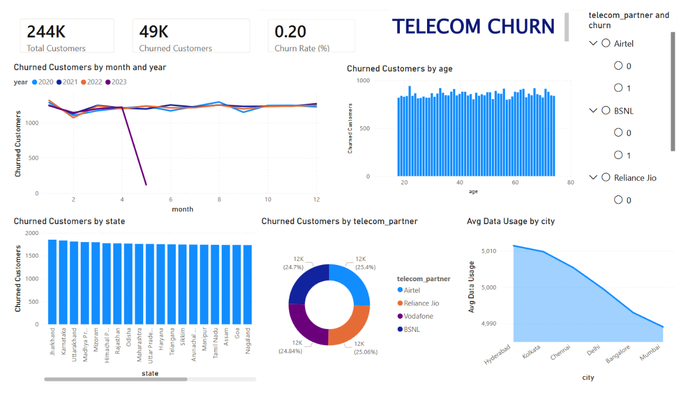

# Telecom Customer Churn Analysis

A data warehousing and analytics project exploring telecom customer churn with Python, PostgreSQL, SQL OLAP queries, machine-learning models, and a Power BI dashboard.



## Dashboard

The dashboard summarizes churn patterns across customer, partner, location, and registration-time dimensions. The supporting views show state-level roll-up, date drill-down, and a churn-only slice.

<details>
<summary>View the supporting dashboard screenshots</summary>

| Roll-up by state | Registration drill-down |
|:--|:--|
|  |  |

| Churned-customer slice |
|:--|
|  |

</details>

## Project Contents

```text
data/          Source telecom churn dataset
notebooks/     Data preparation, PostgreSQL loading, classification, and clustering
sql/           Star-schema DDL and OLAP queries
dashboard/     Power BI report, PDF export, and screenshots
docs/          Project report, proposal, and course brief
requirements.txt
```

## Workflow

1. Load and preprocess the CSV in `notebooks/etl.ipynb` (date handling, missing values, and gender encoding).
2. Load the prepared records into PostgreSQL as `stg_telecom_churn`.
3. Run `sql/sql_script.sql` in the `telecom_dw` database to build customer, geography, partner, and time dimensions with a churn fact table. The script also includes roll-up, drill-down, slice, dice, top-city, and monthly churn queries.
4. Open `dashboard/telecom-churn-dashboard.pbix` in Power BI Desktop to explore the report.
5. The notebook also compares logistic regression, scaled logistic regression, and a decision tree, and runs K-means clustering.

The included CSV has 243,553 records; 48,827 are marked as churned (about 20.05%).

## Run Locally

Requirements: Python, Jupyter, and PostgreSQL. The notebook's ETL cell creates the `telecom_dw` database, so the configured PostgreSQL account must be allowed to create databases.

```powershell
py -m venv .venv
.\.venv\Scripts\Activate.ps1
python -m pip install -r requirements.txt
$env:TELECOM_DB_USER = "postgres"
$env:TELECOM_DB_PASSWORD = Read-Host "PostgreSQL password"
jupyter notebook notebooks/etl.ipynb
```

Optional connection settings are `TELECOM_DB_HOST` (defaults to `localhost`) and `TELECOM_DB_PORT` (defaults to `5432`). Run the notebook cells in order. The source-data lookup works whether the notebook kernel starts in the repository root or in `notebooks/`.

After the ETL cell finishes, connect to the `telecom_dw` database and execute `sql/sql_script.sql` to build the warehouse tables.

## Data and Privacy

This repository includes customer-level records with identifiers, location, demographic, salary, and usage fields. Keep the GitHub repository **private** unless you have confirmed the dataset's distribution rights and cleared it for public release. Do not commit database passwords or other credentials; the notebook reads its database credentials from environment variables.
